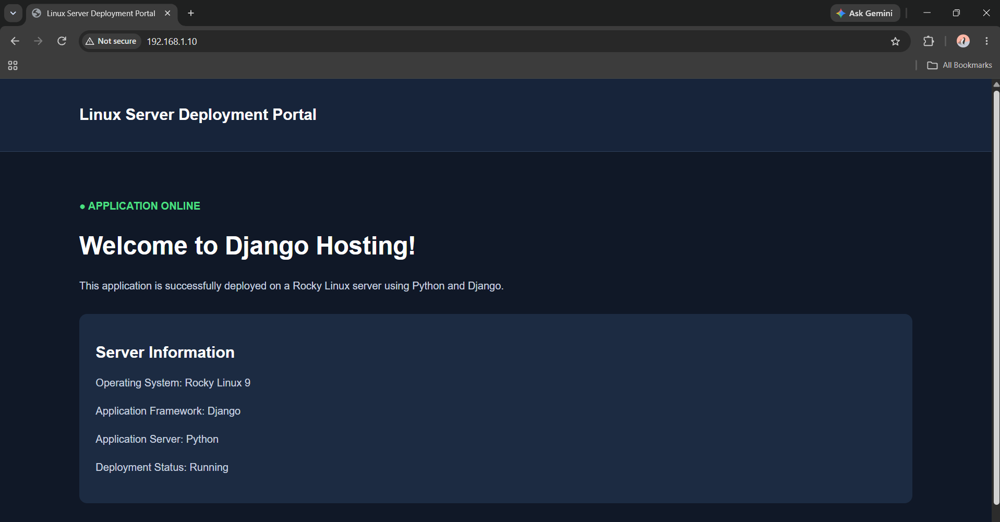

# Django Application Deployment on Rocky Linux 9

A production-style deployment of a Django web application on **Rocky Linux 9**, using **Gunicorn, Nginx, systemd, and a dedicated Linux service account**.

This project demonstrates practical Linux system administration skills involved in deploying, configuring, securing, and managing a Python web application on a Linux server.

## Project Overview

The application is a simple Linux Server Deployment Portal built with Django. It is deployed on a Rocky Linux 9 server using Gunicorn as the WSGI application server and Nginx as a reverse proxy.

The deployment includes a dedicated service account, Python virtual environment, systemd service management, environment-based configuration, firewall rules, and SELinux configuration.

## Deployment Architecture

```text
             Client Browser
                   |
                   | HTTP :80
                   |
                Nginx
             (Reverse Proxy)
                   |
                   | 127.0.0.1:8000
                   |
               Gunicorn
             (3 Workers)
                   |
                   |
             Django Application
                   |
                   |
             SQLite Database
                   |
                   |
       /var/lib/django-deployment/
```

## Technology Stack

| Category | Technologies |
|---|---|
| Operating System | Rocky Linux 9 |
| Programming Language | Python 3 |
| Web Framework | Django 4.2 |
| WSGI Server | Gunicorn |
| Web Server | Nginx |
| Process Management | systemd |
| Database | SQLite |
| Security | SELinux, firewalld |
| Version Control | Git, GitHub |

## Key Implementation Details

### 1. Linux Server Preparation
- Prepared a Rocky Linux 9 environment for application deployment.
- Installed Python, pip, Git, and Nginx.
- Created an isolated Python virtual environment.
- Installed Django and application dependencies.

### 2. Django Application Setup
- Created a Django project with a separate application module.
- Configured application URLs, views, templates, and settings.
- Configured allowed hosts for server access.
- Verified application functionality using Django's development server.

### 3. Gunicorn Configuration
- Installed Gunicorn inside the Python virtual environment.
- Configured Gunicorn to serve the Django WSGI application.
- Configured three Gunicorn worker processes.
- Bound Gunicorn to `127.0.0.1:8000` to prevent direct external access to the application server.

### 4. systemd Service Management
- Created a dedicated Linux service account named `djangoapp`.
- Configured Gunicorn as a systemd service.
- Enabled automatic startup during system boot.
- Configured automatic restart when the service fails.
- Restricted writable application paths.

### 5. Nginx Reverse Proxy
- Configured Nginx to listen on HTTP port 80.
- Forwarded incoming requests to Gunicorn on `127.0.0.1:8000`.
- Configured proxy headers to forward client request information.
- Validated the Nginx configuration before starting the service.

### 6. Linux Security and Permissions
- Configured application ownership and group-based permissions.
- Ran the application using a dedicated non-root service account.
- Stored the Django secret key and runtime settings outside the project directory.
- Restricted access to the environment configuration file.
- Kept SELinux enabled and configured the required HTTP network connection permission.
- Configured firewalld to allow HTTP traffic.

### 7. Database Configuration
- Used SQLite for application data storage.
- Moved the database outside the application source directory.
- Assigned ownership and permissions to the dedicated Django service account.

## Project Directory Structure

```text
/opt/django-deployment/
│
├── config/
│   ├── __init__.py
│   ├── settings.py
│   ├── urls.py
│   ├── wsgi.py
│   └── asgi.py
│
├── dashboard/
│   ├── migrations/
│   ├── templates/
│   │   └── dashboard/
│   │       └── index.html
│   ├── views.py
│   ├── urls.py
│   └── apps.py
│
├── deployment/
│   ├── nginx/
│   │   └── django.conf
│   └── systemd/
│       └── django.service
│
├── screenshots/
│   └── chromeload.png
│
├── .env.example
├── .gitignore
├── manage.py
└── README.md
```

> The Python virtual environment and SQLite database are maintained separately from the source files and are excluded from Git.

## Important Configuration Locations

| Component | Configuration |
|---|---|
| Django project | `/opt/django-deployment/config/` |
| Gunicorn systemd service | `/etc/systemd/system/django.service` |
| Nginx virtual host | `/etc/nginx/conf.d/django.conf` |
| Environment variables | `/etc/django-deployment.env` |
| SQLite database | `/var/lib/django-deployment/db.sqlite3` |
| Python virtual environment | `/opt/django-deployment/venv/` |

## Service Management Commands

**Django / Gunicorn**

```bash
systemctl status django
systemctl start django
systemctl stop django
systemctl restart django
systemctl enable django
journalctl -u django -f
```

**Nginx**

```bash
nginx -t
systemctl status nginx
systemctl restart nginx
systemctl reload nginx
journalctl -u nginx -f
```

**Deployment Verification**

```bash
# Verify Gunicorn listening port
ss -tulnp | grep 8000

# Test Gunicorn directly
curl -I http://127.0.0.1:8000

# Test Nginx
curl -I http://127.0.0.1

# Check firewall configuration
firewall-cmd --list-all

# Check SELinux status
getenforce
```

## Deployment Screenshot

### Django Application Running in Browser



## Skills Demonstrated

- Linux server administration
- Python application deployment
- Django and Gunicorn configuration
- Nginx reverse proxy setup
- systemd service management
- Linux users, groups, and permissions
- Environment variable and secret management
- Firewall configuration using firewalld
- SELinux troubleshooting
- Application service monitoring and log analysis
- Git and GitHub version control

## Learning Outcome

Successfully deployed and hosted a Django application on Rocky Linux 9 using a production-style service architecture.

This project provided hands-on experience with Linux application hosting, web server configuration, process management, service isolation, security controls, and application troubleshooting.

---

**Author:** [abhiiijith](https://github.com/abhiiijith)

**Repository:** [django-linux-deployment](https://github.com/abhiiijith/django-linux-deployment)
